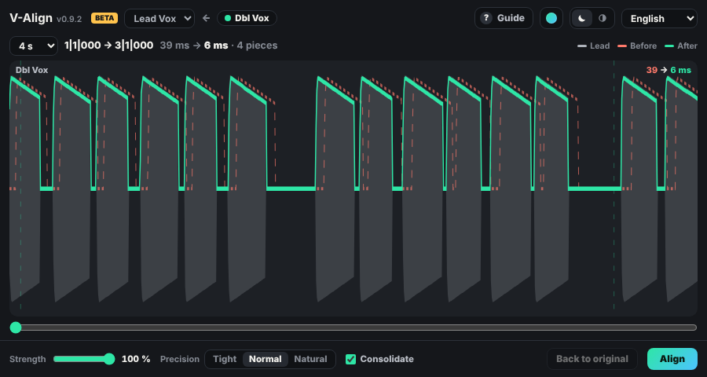
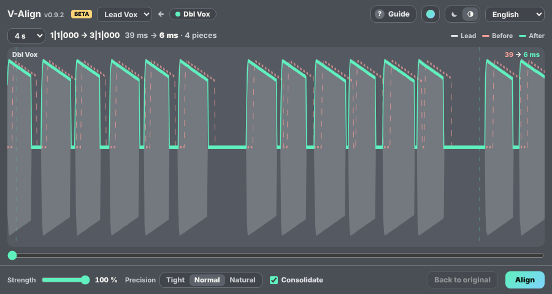

# V-Align for LUNA (beta)

An attempt at a free vocal aligner for LUNA. V-Align puts doubles and backing vocals in time
with the lead: it matches each one to the lead, then moves and stretches it piece by piece with
LUNA's own time-stretch. The unedited take is kept in a new version (V2) first, so you can
always go back.

  
  

## This is a beta: help us improve it

If something goes wrong or sounds odd, **Alt-click the version number** at the top of the window
(next to "V-Align"). It copies a short report: what you selected, the settings and what happened.
Paste it in an email to fedetrillo@gmail.com or in the V-Align thread on Discord, and tell us
what you heard. Every report helps.

## How to use it

1. In LUNA, select the lead vocal and one or more doubles or backing vocals (audio tracks) and,
   if you like, a range. Short sections (a verse, a chorus) give the best results.
2. In **V-Align**, pick which track is the lead (top left). The view shows the lead in grey, the
   double as it is now in red and how it will be in colour.
3. Set **Strength** (100 % is tight; around 80 % keeps some life) and **Precision**: Tight
   (5 ms, more pieces), Normal (10 ms) or Natural (20 ms, fewer pieces).
4. Press **Align**. For each double, V-Align first saves it unedited in a new version (V2), then
   cuts it, moves and stretches every piece, crossfades the joins and, with **Consolidate** on,
   leaves it as a single clip.
5. **Back to original** makes the unedited version active again in one click. The aligned one
   stays in LUNA's version list to compare.

## Good to know

- V-Align compares the shape of the voices (when each syllable starts), not their pitch, so it
  works best on a double of the same line by the same singer.
- Whole songs work, but take longer and ask a lot of LUNA (hundreds of stretched pieces). If
  LUNA gets slow, work section by section.
- Dark and grey themes, seven colours, 7 languages, and a getting-started guide (the **Guide**
  button).

## Install

Requires LUNA 3.1.2 or later. Download `v-align.lunaaddon` from the latest release and
double-click it. Then open a session and choose **Add Ons > Windows > V-Align**.

## En español

Un intento de alineador de voces gratuito para LUNA (beta). Pone las dobladas y los coros a
tiempo con la voz principal: V-Align compara cada una con la principal y la mueve y estira trozo a trozo con el
estiramiento de LUNA. Antes guarda la toma sin editar en una versión nueva (V2), así que siempre
puedes volver. Si algo falla, **Alt-clic en el número de versión** copia un informe: mándalo a
fedetrillo@gmail.com o al hilo de V-Align en Discord.

## Licence

Copyright (c) 2026 Fede Trillo. All rights reserved. Free to install and use in LUNA; the code
may not be copied, modified or redistributed. See [LICENSE](LICENSE). The bundled LUNA Builder
SDK is Universal Audio's, under the Apache License 2.0: see
[THIRD_PARTY_NOTICES.md](THIRD_PARTY_NOTICES.md).

Contact: fedetrillo@gmail.com
